# 🗺️ Atlas de algoritmos

Todas las láminas del curso para **elegir, explicar y evaluar** un modelo, de lo general a lo concreto. Haz clic en una imagen para verla a tamaño completo.

## ¿Qué necesito?

| Quiero… | Abre |
|---|---|
| Ver el **mapa general** de la IA | [Empieza aquí](#empieza-aquí) |
| Decidir **qué enfoque** usar (ML clásico, red, visión, texto, LLM) | [¿Qué enfoque uso?](#qué-enfoque-uso) |
| **Elegir algoritmo** y saber cuándo usarlo y con qué cuidado | [Fichas por algoritmo](#fichas-por-algoritmo) |
| Ver **todo el camino** de un problema, de la pregunta a la métrica | [Caminos del problema a la métrica](#caminos-del-problema-a-la-métrica) |
| **Tocar** los conceptos y buscar un término | [Practica y consulta](#practica-y-consulta) |

## Empieza aquí
<table>
<tr><td align="center" valign="top" width="33%"><a href="../sprints/S01/4_Referencia/infografias/S01_04_tipos_de_aprendizaje_y_algoritmos.png">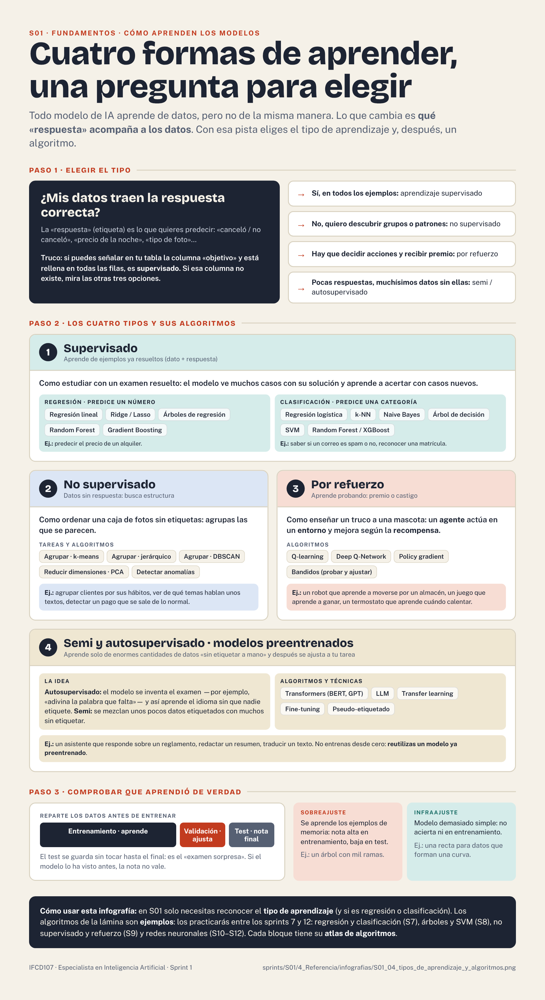</a> <b>Tipos de aprendizaje y algoritmos</b> S1 · el mapa general: supervisado, no supervisado y por refuerzo.</td><td align="center" valign="top" width="33%"><a href="../sprints/S01/4_Referencia/infografias/S01_05_matriz_de_confusion.png">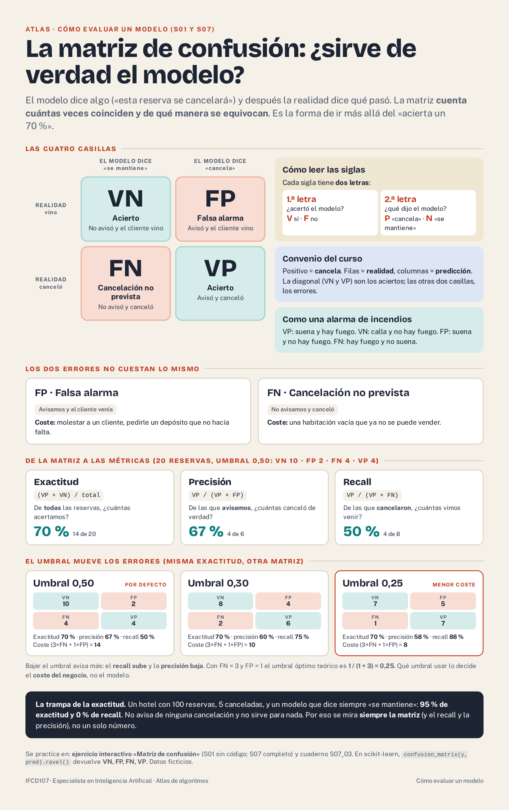</a> <b>La matriz de confusión</b> S1 · las cuatro casillas, exactitud, precisión, recall y el umbral.</td><td align="center" valign="top" width="33%"><a href="../sprints/S01/4_Referencia/infografias/S01_06_bueno_o_malo_metricas.png">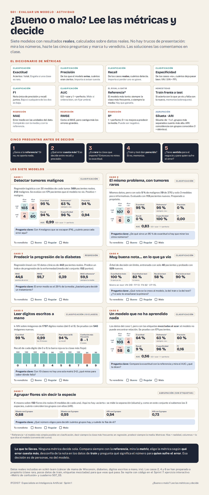</a> <b>¿Bueno o malo?</b> S1 · siete modelos con resultados reales para practicar a leer métricas.</td></tr>
</table>

## Fichas por algoritmo
Una lámina por bloque del curso, con **una ficha por algoritmo**: dibujo de la idea, qué hace, **cuándo usarlo**, **con qué tener cuidado** y dónde se practica (presentación y cuaderno).

<table>
<tr><td align="center" valign="top" width="33%"><a href="../sprints/S07/4_Referencia/infografias/S07_03_atlas_regresion_y_clasificacion.png">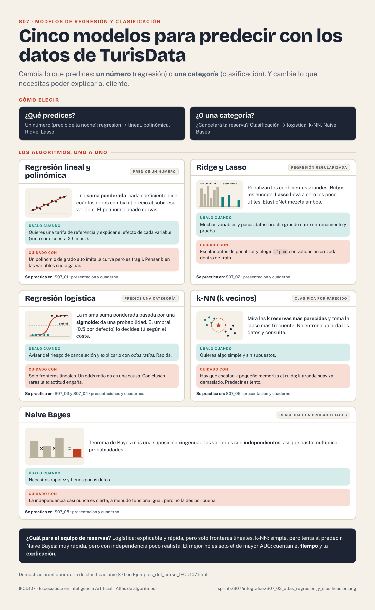</a> <b>S7 · Regresión y clasificación</b> Regresión lineal y polinómica · Ridge y Lasso · logística · k-NN · Naive Bayes</td><td align="center" valign="top" width="33%"><a href="../sprints/S08/4_Referencia/infografias/S08_03_atlas_arboles_ensembles_y_svm.png">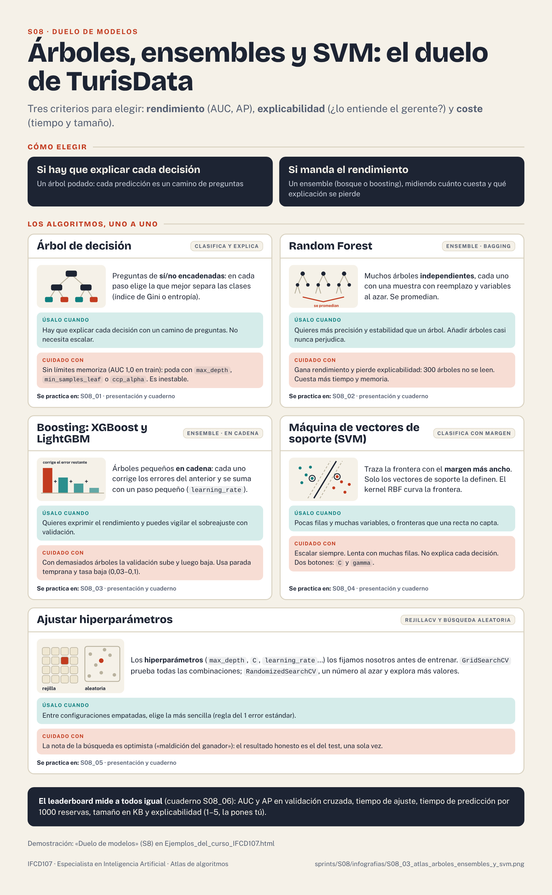</a> <b>S8 · Árboles, ensembles y SVM</b> Árbol · Random Forest · boosting (XGBoost, LightGBM) · SVM · hiperparámetros</td><td align="center" valign="top" width="33%"><a href="../sprints/S09/4_Referencia/infografias/S09_03_atlas_no_supervisado_y_refuerzo.png">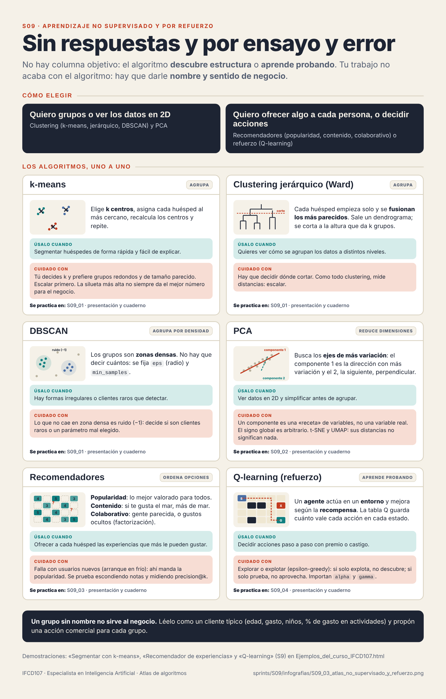</a> <b>S9 · No supervisado y refuerzo</b> k-means · jerárquico (Ward) · DBSCAN · PCA · recomendadores · Q-learning</td></tr>
<tr><td align="center" valign="top" width="33%"><a href="../sprints/S10/4_Referencia/infografias/S10_03_atlas_redes_neuronales_y_vision.png">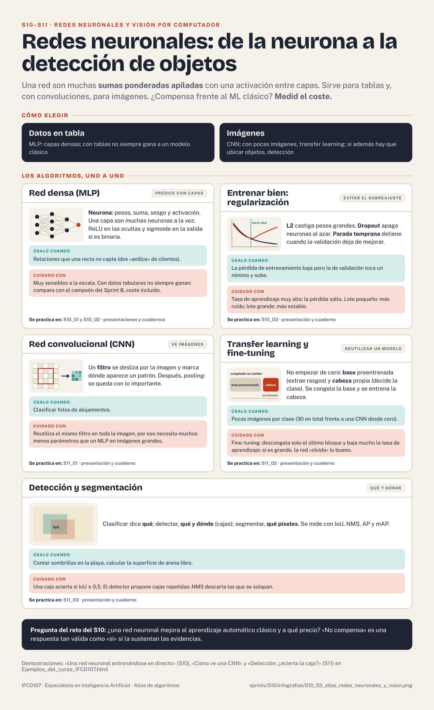</a> <b>S10–S11 · Redes neuronales y visión</b> MLP · L2, Dropout, parada temprana · CNN · transfer learning · detección y segmentación</td><td align="center" valign="top" width="33%"><a href="../sprints/S12/4_Referencia/infografias/S12_03_atlas_series_lenguaje_y_generativa.png">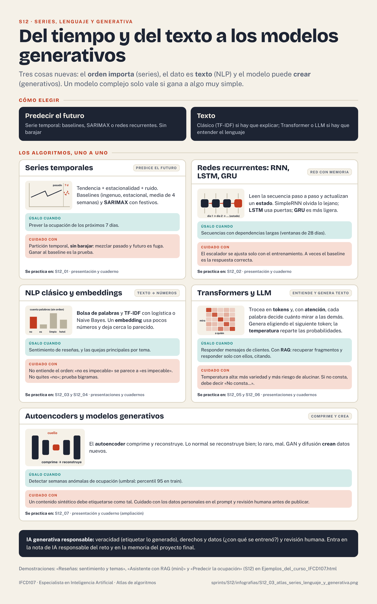</a> <b>S12 · Series, lenguaje y generativa</b> Series (baselines, SARIMAX) · RNN, LSTM, GRU · NLP y embeddings · Transformers y LLM · autoencoders</td><td></td></tr>
</table>

## Caminos del problema a la métrica
Cada lámina sigue el mismo recorrido —**qué pregunta, con qué modelo, qué miro, cómo sé si vale**— para un tipo de problema. Cambia el modelo; el camino no.

<table>
<tr><td align="center" valign="top" width="33%"><a href="../sprints/S06/4_Referencia/infografias/S06_05_flujo_tabla_al_modelo.png">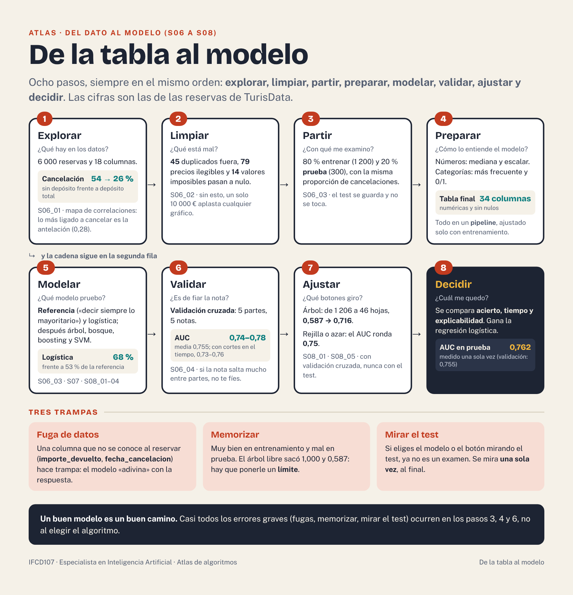</a> <b>Del dato al modelo</b> S6 a S8 · explorar, limpiar, partir, preparar, modelar, validar, ajustar, decidir.</td><td align="center" valign="top" width="33%"><a href="../sprints/S07/4_Referencia/infografias/S07_05_flujograma_problema_a_metrica.png">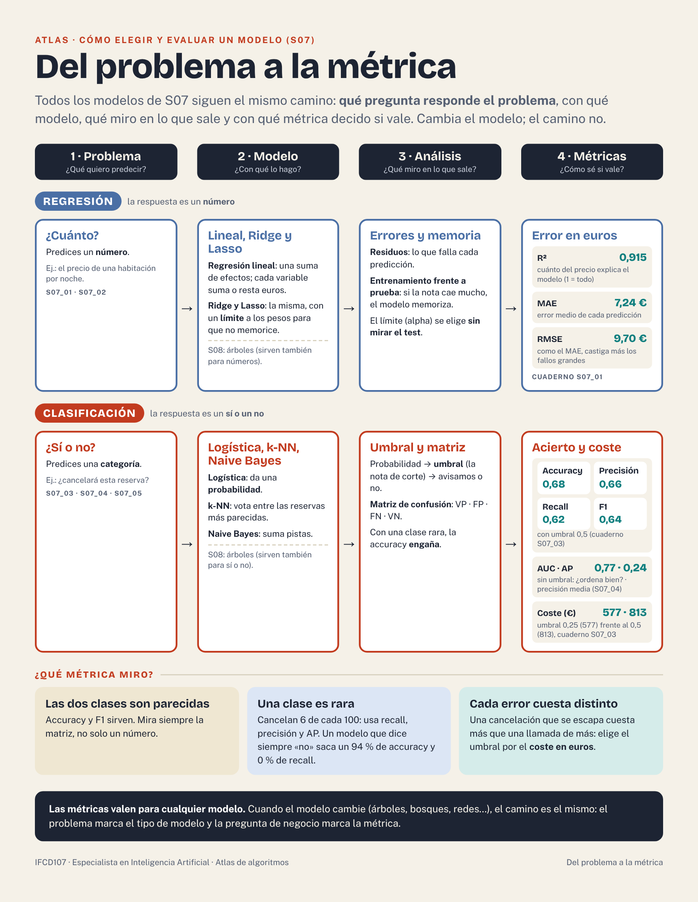</a> <b>Del problema a la métrica</b> S7 · regresión y clasificación: problema → modelo → análisis → métricas.</td><td align="center" valign="top" width="33%"><a href="../sprints/S09/4_Referencia/infografias/S09_05_flujo_sin_respuestas.png">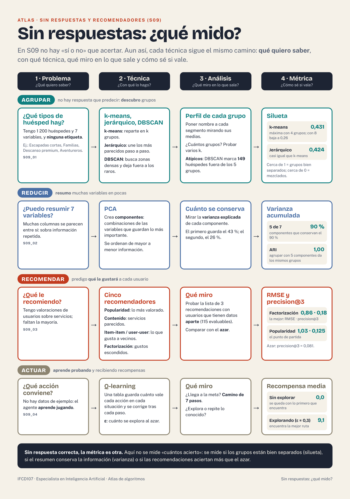</a> <b>Sin respuestas: ¿qué mido?</b> S9 · agrupar, reducir, recomendar y actuar.</td></tr>
<tr><td align="center" valign="top" width="33%"><a href="../sprints/S10/4_Referencia/infografias/S10_05_flujo_entrenar_red.png">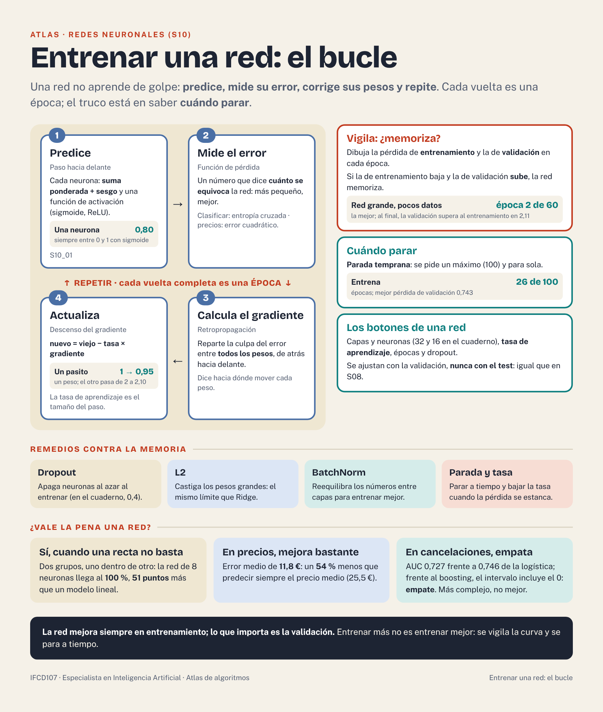</a> <b>Entrenar una red: el bucle</b> S10 · predecir, medir el error, corregir y repetir (épocas).</td><td align="center" valign="top" width="33%"><a href="../sprints/S11/4_Referencia/infografias/S11_05_flujo_imagenes_series_texto_rag.png">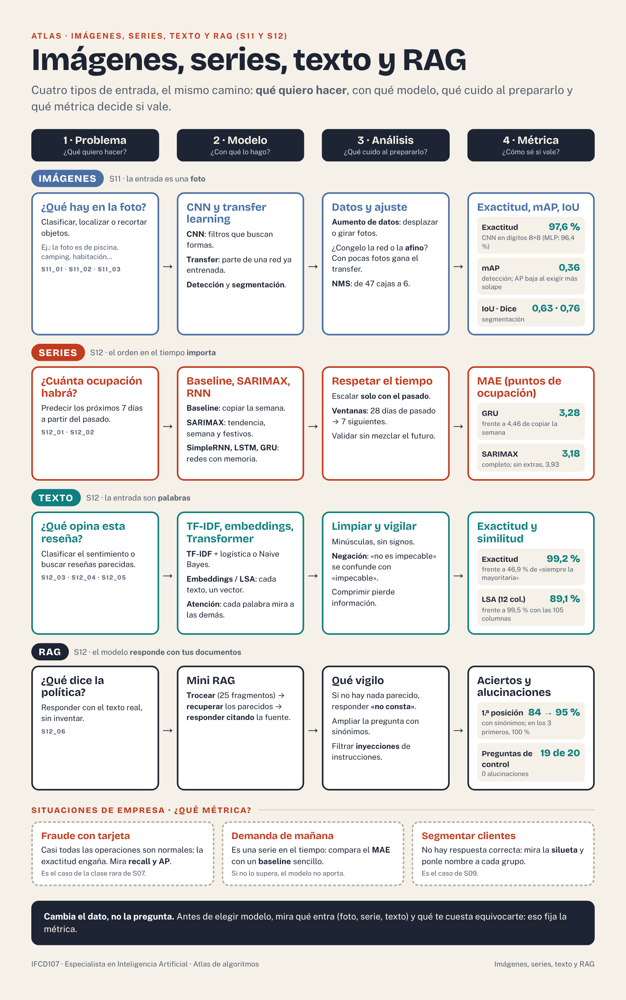</a> <b>Imágenes, series, texto y RAG</b> S11 y S12 · del problema a la métrica según el tipo de dato.</td><td></td></tr>
</table>

## ¿Qué enfoque uso?
Antes de elegir algoritmo hay que elegir **enfoque**: ML clásico, red neuronal, visión, texto o LLM. No lo decide lo moderno que sea el modelo, sino **tres preguntas**: qué **dato** tienes, **cuántos** hay y si hay que **explicar** cada decisión. Pruébalo con tus propios datos en el laboratorio [**¿Qué enfoque uso?**](https://ccoolboox.github.io/IFCD107-alumnado/material/Diccionario_visual_IA.html#lab-enfoque) (incluye 7 casos de TurisData para repasar).

| Si tu dato es… | Empieza por (baseline) | Enfoque recomendado | Sube de nivel si… | Se practica en |
|---|---|---|---|---|
| **Tabla**, hay que explicar | Una regla o la clase más frecuente | **ML clásico explicable**: regresión logística o árbol | Un ensemble mejora de verdad y sabes qué explicación pierdes | S7, S8 |
| **Tabla**, cientos de filas | La clase más frecuente | **ML clásico sencillo** con validación cruzada | Antes que un modelo mayor, consigue más datos | S7, S8 |
| **Tabla**, miles de filas | Regresión logística o lineal | **Ensemble de árboles** (bosque o boosting) | Una red densa (MLP) gana por margen claro y compensa su coste | S8, S10 |
| **Tabla**, cientos de miles | Regresión logística o lineal | **Boosting** primero; la **red densa** como candidata | El MLP mejora al boosting con la misma validación | S8, S10 |
| **Imágenes** etiquetadas | Modelo clásico sobre color o tamaño, o la clase más frecuente | **CNN con transfer learning** (con pocas imágenes, solo la última capa; con miles, ajuste fino) | Hay que ubicar los objetos: detección o segmentación | S11 |
| **Texto** etiquetado, pocos datos o hay que explicar | Diccionario de palabras | **TF-IDF + modelo clásico** | El contexto importa (ironía, negaciones) y no hay que explicar cada palabra | S12 |
| **Texto** etiquetado, miles y sin necesidad de explicar | TF-IDF + regresión logística (siempre primero) | **Transformer preentrenado** con ajuste fino | No mejora al baseline por margen claro: quédate con el baseline | S12 |
| **Responder o escribir** con documentos | Búsqueda por palabras clave (TF-IDF) | **LLM preentrenado con RAG** | El estilo o el dominio lo exigen y tienes ejemplos: ajuste fino | S12 |
| **Serie en el tiempo** | Repetir el último valor o la misma semana del año pasado | **Baseline y SARIMAX**, sin barajar los datos | Una red recurrente gana al baseline y hay muchos datos | S12 |
| **Sin etiquetas** | Describir los datos (EDA) | **No supervisado**: k-means, PCA | Quieres ofrecer algo a cada persona: recomendadores | S9 |
| **Una regla basta** (aviso a las 48 h, umbral fijo) | La propia regla | **Sin IA**: reglas sencillas | — | S14 |

**Regla de oro:** una red neuronal solo se justifica si gana al baseline y al modelo clásico **con margen claro** y compensa su coste, su opacidad y sus datos. Con tablas, muchas veces no gana. Anota en la ficha del proyecto (S14) qué fila de esta tabla has seguido y por qué.

## Practica y consulta
- 🔎 **Diccionario visual de IA** · [ábrelo online](https://ccoolboox.github.io/IFCD107-alumnado/material/Diccionario_visual_IA.html) (también en [`Diccionario_visual_IA.html`](Diccionario_visual_IA.html), sin internet). Quince laboratorios para **tocar** (¿qué enfoque uso?, regresión lineal, matriz de confusión, descenso del gradiente, escalado y atípicos, Bayes, k-NN, árbol de decisión, regresión logística, k-means, PCA, convolución, Q-learning, temperatura de un LLM y TF-IDF) y un glosario de **75 términos** con dibujo, con buscador y enlace a la presentación y al cuaderno donde se practica cada uno.
- 🧪 **Demostraciones del curso** · [`Ejemplos_del_curso_IFCD107.html`](../sprints/S00/actividades/Ejemplos_del_curso_IFCD107.html).

## Cómo usarlo en un reto
1. **Antes de elegir modelo**, mira «Cómo elegir» arriba de la lámina del sprint.
2. **Al decidir**, lee «Úsalo cuando» y «Cuidado con» de los candidatos y anota en el informe por qué elegís uno y descartáis otro.
3. **Para practicar**, cada ficha indica la presentación y el cuaderno del sprint; las demostraciones interactivas están en [`Ejemplos_del_curso_IFCD107.html`](../sprints/S00/actividades/Ejemplos_del_curso_IFCD107.html).
4. **Recuerda:** el mejor modelo no es solo el de mayor métrica. Cuentan el tiempo, el tamaño, la explicación y el sentido de negocio.
