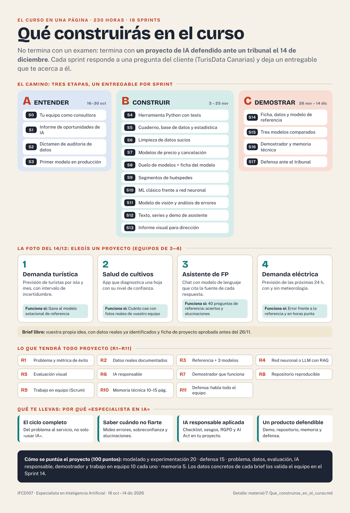

# 🏗️ Qué construirás en el curso

**230 horas · 16 de octubre – 14 de diciembre de 2026.** Este curso no termina con un examen: termina con **un proyecto de IA defendido ante un tribunal**. Aquí tienes cómo es ese proyecto (la «foto» del 14/12) y qué vas construyendo, sprint a sprint, para llegar a él.

---

## 1. La foto del proyecto final (14/12)

En los **Sprints 14–17** (26/11 – 14/12), tu equipo de 3–4 personas resuelve un problema real **de principio a fin**. Esto es lo que tendréis el 14 de diciembre:

| # | Qué tendréis | La prueba de que lo habéis hecho bien |
|---|---|---|
| R1 | Un **problema bien definido** | Una métrica de éxito **de negocio** y otra **técnica** |
| R2 | **Datos reales** | Fuente y licencia documentadas, análisis exploratorio e informe de calidad del dato |
| R3 | **Modelos comparados** | Un modelo de referencia (*baseline*) y **al menos 3 modelos**, validados sin hacer trampas (sin fuga de datos) |
| R4 | **Una red neuronal** (o un modelo de lenguaje con RAG) | Entrenada y evaluada, no solo usada |
| R5 | **Evaluación visual** | Matriz de confusión, curvas, importancia de variables, SHAP o Grad-CAM, según el caso |
| R6 | **IA responsable** | El checklist ético del Sprint 1 actualizado, sesgos, limitaciones y clasificación de riesgo (RGPD y AI Act) |
| R7 | **Un demostrador que funciona** | App (Streamlit o Gradio), cuaderno interactivo o servicio |
| R8 | **Un repositorio reproducible** | README, requisitos y commits de **todas** las personas del equipo |
| R9 | **Evidencia de trabajo en equipo** | Tablero, backlog y planning, review y retrospectiva de cada sprint |
| R10 | **Una memoria técnica** | De 10 a 15 páginas |
| R11 | **Una defensa** | **Todas** las personas del equipo presentan y responden preguntas |

### ¿Qué proyecto? Elegís entre 4 (o proponéis uno)

| Brief | Qué construís | Cómo sabéis que funciona |
|---|---|---|
| **1 · Demanda turística** | Previsión de llegada de turistas por isla y mes, con 3–6 meses de antelación, con su intervalo de incertidumbre y una nota de recomendaciones para el cliente | Que **gane al modelo de referencia estacional** en un periodo posterior al entrenamiento |
| **2 · Salud de cultivos** | Una app: subes la foto de una hoja y devuelve el diagnóstico **con nivel de confianza y aviso de incertidumbre** | Cuánto **cae el rendimiento** al pasar de las imágenes del dataset a fotos reales hechas por vuestro equipo |
| **3 · Asistente de FP** | Un chat que responde dudas sobre ciclos formativos con un modelo de lenguaje y **cita la fuente** de cada respuesta | Un conjunto de **40 preguntas de referencia**: aciertos, respuestas sin fuente y **alucinaciones** |
| **4 · Demanda eléctrica** | Previsión de la demanda de las próximas 24 h, con y sin meteorología, y un demostrador de demanda real frente a la prevista | Error frente al modelo de referencia, y **error en horas punta** |
| **Brief libre** | Vuestra propia idea, con datos reales ya identificados | Cumplir **R1–R11** y la ficha de proyecto antes del 26/11 |

*Los datos concretos de cada brief los valida el equipo en el Sprint 14. Detalle y rúbrica completa: [`proyecto-final/briefs_y_rubrica.md`](../proyecto-final/briefs_y_rubrica.md).*

---

## 2. Sprint a sprint: qué construyes y qué sabrás hacer

Cada sprint responde a **una pregunta del cliente** (TurisData Canarias) y termina en **un entregable**.

### 🟦 Etapa A · Entender (Sprints 0–3, del 16 al 27/10)

> 🖼️ Resumen visual del bloque Entender (Sprints 0–3): [`img/bloque_entender.png`](img/bloque_entender.png)

| Sprint | Fechas | Qué construyes | Qué sabrás hacer |
|---|---|---|---|
| **0** | 16–19/10 | Tu equipo como consultora: tablero, acuerdo de trabajo, *Definition of Done* y mapa de empatía con preguntas de diseño | Trabajar con Scrum de verdad y **escuchar a un cliente** antes de ofrecerle soluciones |
| **1** | 20–21/10 | **Informe de oportunidades de IA** (5 casos) y checklist ético | **Distinguir** los tipos de IA y de aprendizaje y **detectar riesgos** antes de construir nada |
| **2** | 22–23/10 | Dictamen de auditoría de un informe y recomendación sobre un canal | **No creerte una estadística** solo porque salga en un informe |
| **3** | 26–27/10 | **Primer modelo en producción**: informe del mejor modelo (AutoML), llamada a su API e informe de costes | Recorrer un proyecto **del dato al servicio**, y **vigilar el coste** y cerrar los recursos |

### 🟩 Etapa B · Construir (Sprints 4–13, del 28/10 al 25/11)

| Sprint | Fechas | Qué construyes | Qué sabrás hacer |
|---|---|---|---|
| **4** | 28–29/10 | Una **herramienta interna** en Python (`kpis.py`) con tests, que genera un `salida.json` desde un CSV real | Convertir un trabajo manual en algo **repetible**, **probar** tu código y usar **Git** |
| **5** | 30/10 y 3/11 | Un cuaderno, una base de datos y la respuesta al cliente a «¿la ocupación depende de esto?» | Entender cómo «aprende» un modelo, medir **cuánta confianza** hay en un resultado y por qué **correlación no es causalidad** |
| **6** | 4–5/11 | Un **informe de calidad** de datos sucios y un cuaderno que los limpia | **Encontrar los defectos** de un dato real, decidir qué hacer con cada uno y dejarlo escrito en código |
| **7** | 6 y 9/11 | Modelos de **precio y cancelación**, con informe de modelado | Elegir métricas según el problema, **evitar la fuga de datos** y traducir un modelo a dinero |
| **8** | 10–11/11 | El **duelo de modelos**: clasificación (*leaderboard*) y ficha del modelo (*model card*) | Decidir con tres criterios: **rendimiento, explicabilidad y coste** |
| **9** | 12–13/11 | **Segmentos de huéspedes** con nombre y una ficha de 1 página, con nota de IA responsable | **Segmentar sin etiquetas**, comparar recomendadores y ver los riesgos de personalizar |
| **10** | 16–17/11 | Informe comparativo **ML clásico frente a red neuronal** | **Entrenar una red sin que memorice**, leer curvas de aprendizaje y comparar con honestidad |
| **11** | 18–20/11 | Un **modelo de visión**, su demostrador y el análisis de errores | **Reutilizar modelos preentrenados**, interpretar errores y decidir qué se automatiza y qué se revisa a mano |
| **12** | 23–25/11 | Informe de reseñas, **modelo de ocupación**, **demo de un asistente** con su evaluación y nota ética | Trabajar con **texto, series temporales y modelos de lenguaje**, y **evaluar y proteger** un asistente |
| **13** | 25/11 (dentro del 12) | Un **informe visual de una página** para dirección (será la semilla de la memoria) | Convertir un modelo en **una página que se entiende en 30 segundos** |

### 🟧 Etapa C · Demostrar (Sprints 14–17, del 26/11 al 14/12)

| Sprint | Fechas | Qué construyes | Qué sabrás hacer |
|---|---|---|---|
| **14** | 26–30/11 | **Ficha de proyecto**, datos, análisis exploratorio, *baseline*, backlog y plan ético | Plantear un proyecto de IA con **datos reales y una métrica de éxito** y que el cliente lo apruebe |
| **15** | 1–3/12 | **Baseline y 3 modelos comparados**, con registro de experimentos | **Experimentar con método** y elegir un modelo candidato con argumentos |
| **16** | 4–10/12 | **Demostrador** y **memoria técnica** (congelación el 10/12 a las 14:30) | **Evaluar con honestidad**, aplicar IA responsable y entregar algo **reproducible** |
| **17** | 11 y 14/12 | Presentación de máximo 12 diapositivas y **defensa ante el tribunal** | **Contar tu proyecto** a un público no técnico y responder con datos |

---

## 3. Qué te llevas (por qué es un curso de «Especialista en IA»)

- **El ciclo completo, no solo «usar IA».** Defines el problema, preparas los datos, comparas modelos contra una referencia y los evalúas sin trampas.
- **Sabes cuándo no fiarte de un modelo.** Mides errores, sobreconfianza y alucinaciones, y compruebas si funciona con datos reales y no solo con los de laboratorio.
- **IA responsable aplicada.** No solo la explicas: rellenas el checklist, analizas sesgos y clasificas el riesgo según el RGPD y el AI Act.
- **Un producto que se puede defender.** Un demostrador que funciona, un repositorio reproducible, una memoria técnica y una defensa en la que habla todo el equipo, trabajando con Scrum.

**Cómo se evalúa el proyecto (100 puntos):** problema y valor de negocio (10), datos (10), **modelado y experimentación (20)**, evaluación y visualización (10), IA responsable (10), demostrador y reproducibilidad (10), trabajo en equipo (10), memoria (5) y **defensa (15)**.

*Ver también: [Cómo funciona el curso](00_Como_funciona_el_curso.pdf) · [Mi ruta del curso](1.%20Mi_ruta_del_curso.md) · [Atlas de algoritmos](6.%20Atlas_de_algoritmos.md).*
