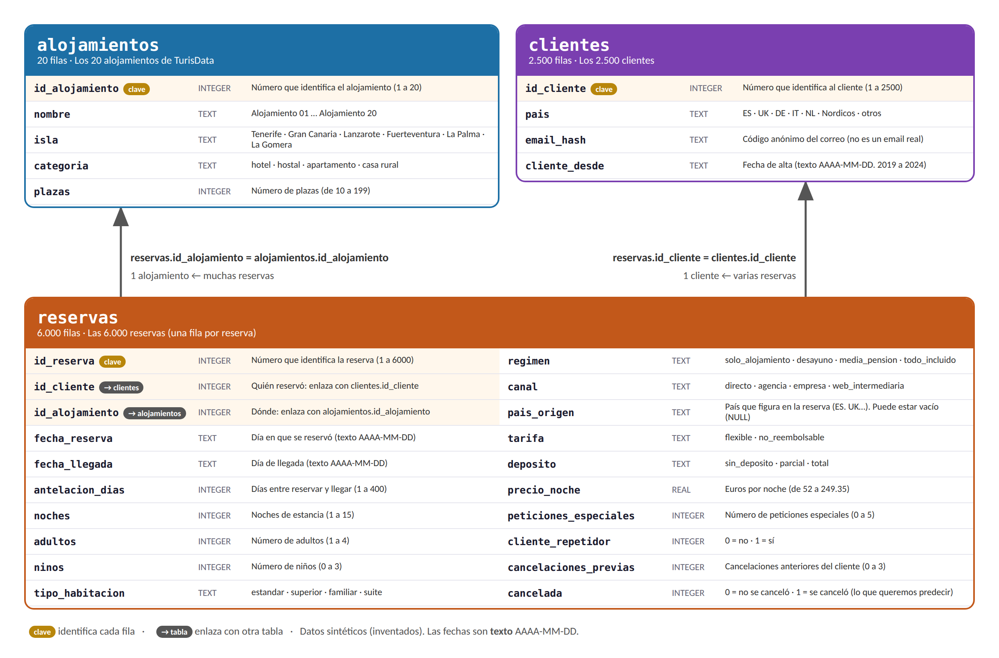

# Esquema de turisdata.db · tablas y campos

**Para qué sirve:** tener **a mano** qué tablas y qué campos tiene la base de datos, para saber **dónde buscar** cada dato cuando un ejercicio lo pide. Tenedlo abierto mientras hacéis los ejercicios de SQL y NoSQL.


---

> Los datos son **sintéticos** (inventados): sirven para practicar, no son estadísticas reales del turismo canario. Las **fechas** son **texto** con formato `AAAA-MM-DD`.

## 1. Las tres tablas

La base tiene **tres tablas**. Las dos pequeñas (`alojamientos` y `clientes`) se enlazan con `reservas`:

| Tabla | Qué guarda | Filas | Se enlaza con |
|---|---|---|---|
| `alojamientos` | Los alojamientos de TurisData | 20 | `reservas.id_alojamiento` |
| `clientes` | Las personas que reservan | 2.500 | `reservas.id_cliente` |
| `reservas` | **Una fila por reserva** | 6.000 | las dos anteriores |

Para ver a la vez un dato de `reservas` y uno de otra tabla hay que **unirlas con `JOIN`** por esa clave.

---

## 2. Vista general (imagen)



*Si la imagen no se ve bien, abridla en una pestaña nueva y ampliadla, o usad las tablas de abajo.*

---

## 3. Los campos de cada tabla

### `alojamientos` (5 campos)

| Campo | Tipo | Qué es | Valores |
|---|---|---|---|
| `id_alojamiento` | número | **Clave**: identifica el alojamiento | 1 a 20 |
| `nombre` | texto | Nombre | `Alojamiento 01` … `Alojamiento 20` |
| `isla` | texto | Isla donde está | `Tenerife`, `Gran Canaria`, `Lanzarote`, `Fuerteventura`, `La Palma`, `La Gomera` |
| `categoria` | texto | Tipo de alojamiento | `hotel`, `hostal`, `apartamento`, `casa rural` |
| `plazas` | número | Plazas que tiene | 10 a 199 |

### `clientes` (4 campos)

| Campo | Tipo | Qué es | Valores |
|---|---|---|---|
| `id_cliente` | número | **Clave**: identifica al cliente | 1 a 2500 |
| `pais` | texto | País del cliente | `ES`, `UK`, `DE`, `IT`, `NL`, `Nordicos`, `otros` |
| `email_hash` | texto | Código anónimo del correo (no es un email real) | 8 caracteres |
| `cliente_desde` | texto | Fecha de alta | `2019-01-01` a `2024-06-22` |

### `reservas` (20 campos)

| Campo | Tipo | Qué es | Valores |
|---|---|---|---|
| `id_reserva` | número | **Clave**: identifica la reserva | 1 a 6000 |
| `id_cliente` | número | Quién reservó → **`clientes.id_cliente`** | 1 a 2500 |
| `id_alojamiento` | número | Dónde → **`alojamientos.id_alojamiento`** | 1 a 20 |
| `fecha_reserva` | texto | Día en que se reservó | `2024-01-01` a `2025-12-30` |
| `fecha_llegada` | texto | Día de llegada | `2024-01-13` a `2026-12-04` |
| `antelacion_dias` | número | Días entre reservar y llegar | 1 a 400 |
| `noches` | número | Noches de estancia | 1 a 15 |
| `adultos` | número | Adultos | 1 a 4 |
| `ninos` | número | Niños | 0 a 3 |
| `tipo_habitacion` | texto | Tipo de habitación | `estandar`, `superior`, `familiar`, `suite` |
| `regimen` | texto | Régimen de comidas | `solo_alojamiento`, `desayuno`, `media_pension`, `todo_incluido` |
| `canal` | texto | Por dónde se reservó | `directo`, `agencia`, `empresa`, `web_intermediaria` |
| `pais_origen` | texto | País que figura **en la reserva**. **Puede estar vacío (`NULL`)**: 138 reservas | `ES`, `UK`, `DE`, `IT`, `NL`, `Nordicos`, `otros` |
| `tarifa` | texto | Tipo de tarifa | `flexible`, `no_reembolsable` |
| `deposito` | texto | Depósito pagado | `sin_deposito`, `parcial`, `total` |
| `precio_noche` | decimal | Euros por noche | 52 a 249,35 |
| `peticiones_especiales` | número | Peticiones especiales | 0 a 5 |
| `cliente_repetidor` | número | ¿Ya había reservado? | `0` = no, `1` = sí |
| `cancelaciones_previas` | número | Cancelaciones anteriores del cliente | 0 a 3 |
| `cancelada` | número | **¿Se canceló la reserva?** (lo que queremos predecir) | `0` = no, `1` = sí |

---

## 4. «Si el enunciado habla de…, buscad en…»

| El enunciado habla de… | Está en… | Ojo con… |
|---|---|---|
| El **nombre**, la **isla**, la **categoría** o las **plazas** de un alojamiento | `alojamientos` | En `reservas` solo hay su número (`id_alojamiento`): hace falta un `JOIN` |
| El **país del cliente**, o desde cuándo es cliente | `clientes` (`pais`, `cliente_desde`) | Es distinto de `reservas.pais_origen` |
| Reservas **«sin país de origen»** | `reservas.pais_origen` | Se pregunta con `IS NULL`, no con `= NULL` |
| **Canceladas** / **no canceladas** | `reservas.cancelada` (1 / 0) | Es un número, no la palabra «sí» |
| **Ingreso** de una reserva | **No existe como campo**: se calcula `noches * precio_noche` | Se le da nombre con `AS ingreso` |
| **Tasa de cancelación** (%) | **No existe**: se calcula `100.0 * AVG(cancelada)` | Como `cancelada` vale 0 o 1, su media es la proporción |
| **Mes** de llegada | **No existe**: se saca de `fecha_llegada` con `SUBSTR(fecha_llegada, 1, 7)` | La fecha es texto `AAAA-MM-DD` |
| Reservas de **agosto de 2025** | `fecha_llegada` | `BETWEEN '2025-08-01' AND '2025-08-31'` o `LIKE '2025-08%'` |
| El **canal**, la **tarifa** o el **depósito** | `reservas` (texto) | Escribid el texto **igual** y con comillas simples |

---

## 5. El mismo dato como documento (NoSQL)

En el cuaderno de NoSQL, cada reserva es **un documento** que lleva **dentro** los datos de su alojamiento y de su cliente (no hay `JOIN`). **No incluye todos los campos** de la tabla: solo estos.

| Campo del documento | Equivale a (SQL) |
|---|---|
| `_id` | `reservas.id_reserva` |
| `fecha_reserva`, `fecha_llegada`, `noches`, `canal`, `tarifa`, `deposito`, `tipo_habitacion`, `precio_noche` | el mismo campo de `reservas` |
| `cancelada` | `reservas.cancelada`, pero como **`True` / `False`** (no 1 / 0) |
| `alojamiento.id`, `alojamiento.nombre`, `alojamiento.isla`, `alojamiento.categoria`, `alojamiento.plazas` | campos de `alojamientos` (se escriben **con punto**) |
| `cliente.id`, `cliente.pais` | `clientes.id_cliente` y `clientes.pais` |

**No están** en el documento: `adultos`, `ninos`, `regimen`, `pais_origen`, `antelacion_dias`, `peticiones_especiales`, `cliente_repetidor`, `cancelaciones_previas`.

Ejemplo (la primera reserva, `_id` 5760):

```json
{"_id": 5760, "fecha_reserva": "2024-01-01", "fecha_llegada": "2024-03-21", "noches": 3,
 "canal": "empresa", "tarifa": "flexible", "deposito": "parcial", "tipo_habitacion": "estandar",
 "precio_noche": 89.24, "cancelada": true,
 "alojamiento": {"id": 5, "nombre": "Alojamiento 05", "isla": "Tenerife", "categoria": "hotel", "plazas": 93},
 "cliente": {"id": 1234, "pais": "Nordicos"}}
```

---

**Cifras de control** (para saber que estáis en la base correcta): 6.000 reservas · 20 alojamientos · 2.500 clientes · 2.754 reservas canceladas (45,9 %).

Volved a los ejercicios: [guía de SQL en parejas](../sql/guia_sql_en_parejas.md) · [guía de NoSQL en parejas](../nosql/guia_nosql_en_parejas.md).
