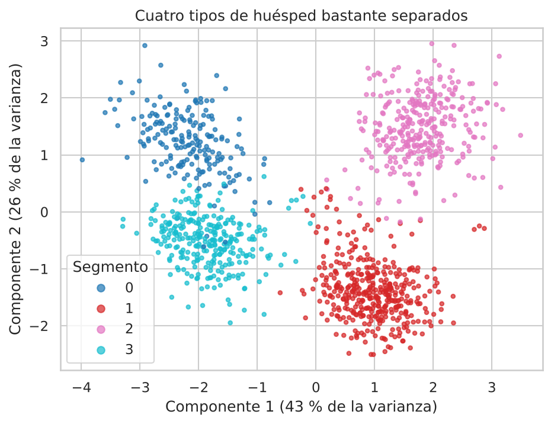

# Ficha de segmentos de huéspedes · TurisData Canarias

**Equipo:** Las Palmeras · **Fecha:** 16/11/2026 · **Método elegido:** k-means · **k = 4** · **Silueta = 0,431**

**¿Por qué este método y este k?** Elegimos k = 4 porque su silueta es la más alta (0,431), aunque 3 (0,415) y 5 (0,414) casi empatan, y, para el negocio, 4 grupos se pueden gestionar: el más pequeño tiene el 16 % de los huéspedes (con 5 grupos habría uno de solo 72, el 6 %).

## Mapa de segmentos

*Cuatro tipos de huésped bastante separados. Componente 1: 43 % de la varianza; componente 2: 26 %; entre las dos, 68,7 %.*

## Segmentos

| Segmento | Nombre comercial | Tamaño (n y %) | Perfil en una frase (cifras concretas) | Acción comercial | Experiencia estrella |
|---|---|---|---|---|---|
| 0 | Escapadas frecuentes | 194 (16 %) | 4 reservas al año y estancias de 2,6 noches, con 22 días de antelación | Oferta de última hora por correo: reservan con unos 22 días de antelación | Observación de cetáceos (3,93) |
| 1 | Familias de larga estancia | 402 (34 %) | 9 de cada 10 viajan con niños, reservan con 110 días de antelación y se quedan 7,4 noches | Pack «Niños gratis en el parque acuático» en la reserva | Parque acuático (3,67) |
| 2 | Mayores de alto gasto | 317 (26 %) | 57 años de media y 211 € de gasto al día, con solo el 20 % en actividades | Mejora de habitación y experiencias tranquilas, con reserva anticipada | Visita a Garachico (4,21) |
| 3 | Jóvenes aventureros | 287 (24 %) | 29 años de media y el 75 % de su gasto en actividades | Newsletter solo con excursiones y deportes, con precio de grupo | Parapente (3,82) |

*Supuesto de las experiencias estrella: los 300 usuarios que valoraron **no son** los de `huespedes.csv`, así que no hay un cruce real. Las elegimos razonando con el perfil de cada segmento y apoyándonos en la nota media del prototipo (entre paréntesis). Los tamaños suman 1.200.*

## Recomendador
- Métodos comparados: popularidad (RMSE 1,029 / precision@3 0,125), item-item (RMSE 0,895 / precision@3 0,171). Valoraciones escondidas: el 20 % (`random_state=42`), 115 usuarios evaluables.
- Método elegido y por qué: Elegimos item-item porque su precision@3 es 0,171 frente a 0,125 de la popularidad y su RMSE es 0,895 frente a 1.029. Con solo 115 usuarios evaluables la prueba es pequeña, pero las diferencias son claras (más de 0,04 en las dos medidas).
- Ejemplo: usuario 1 → recomendaciones: Parque Timanfaya (4,73); Ruta por Anaga (4,14); Zoo y jardines (3,87).
- ¿Qué haría el sistema con un **huésped nuevo sin valoraciones**? Le enseñaría la popularidad (Parque Timanfaya, Visita a Garachico, Observación de cetáceos) hasta que valore dos o tres experiencias; entonces ya se puede usar item-item.

## IA responsable (5 líneas)
- Riesgo 1 (segmentar): discriminar, si se usa la edad o «viaja con niños» para cobrar precios distintos. Medida: usar los segmentos para decidir **qué comunicar**, no para variar precios.
- Riesgo 2 (recomendar): sesgo de popularidad. Lo comprobamos: item-item recomienda 18 experiencias distintas de 25 (la popularidad, 8), pero Parque Timanfaya se repite 160 veces. Medida: reservar un hueco de cada lista a una experiencia menos conocida.
- Datos personales implicados y base legal: edad y si viaja con niños, además del historial de reservas. Los datos del curso son sintéticos; en un caso real harían falta información clara al huésped, consentimiento para las comunicaciones comerciales y minimizar los datos (por ejemplo, edad por tramos).

## Limitaciones
Datos sintéticos, comportamiento de un año, valoraciones escasas (4–11 por usuario), solo 25 experiencias y un mapa 2D que conserva el 69 % de la información. Las valoraciones no son de los huéspedes que segmentamos. No hemos comparado con clustering jerárquico ni DBSCAN.

## Revisión con la rúbrica

**Revisado por:** Persona D (no escribió la ficha) · **Fecha:** 16/11/2026

| Criterio | Nivel (1–4) | Prueba: una frase de lo que has comprobado |
|---|---|---|
| Corrección técnica | 3 | Se ejecuta entero y escala antes de agrupar; hay silueta de k = 2 a 8 y mapa con el % de varianza; item-item se evalúa con el 20 % escondido y `recomendar` se probó con 3 usuarios sin repetir lo ya valorado |
| Reproducibilidad | 3 | Reiniciar y ejecutar todo dio k = 4, tamaños 194, 402, 317, 287 (suman 1.200) y la misma tabla RMSE / precision@3 |
| Análisis y comunicación al cliente | 3 | Cada nombre se apoya en dos cifras, hay acción y experiencia estrella por segmento y la frase de k da la razón técnica y la de negocio; falta priorizar los segmentos por valor |
| IA responsable | 3 | Dos riesgos de este caso con su medida; el de popularidad está comprobado (18 experiencias distintas de 25) y el cuaderno declara qué se pidió a la IA y qué se comprobó |

**Lo primero que mejoraríamos:** Priorizar los cuatro segmentos por valor (gasto al día × tamaño) y contar qué haríamos con un huésped nuevo en la ficha, no solo en el cuaderno.
