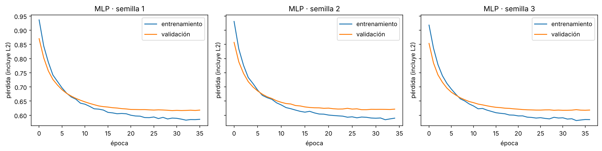

# Informe comparativo · ¿Vale la pena la red? (Sprint 10)

## 1. Pregunta y respuesta
Recomendamos **mantener el boosting de árboles** porque el MLP no mejora de forma demostrable: la diferencia de AUC en la prueba es +0,006 con un intervalo del 95 % de [-0,006, +0,018], que incluye el 0, y la red tarda unas 32 veces más en entrenarse y es menos explicable.

## 2. Resultados
Conjunto de prueba (1.200 reservas, mirado una sola vez):

| Modelo | AUC | AP | F1 | Exactitud |
|---|---|---|---|---|
| Boosting de árboles | 0,738 | 0,722 | 0,639 | 0,672 |
| MLP (media de 3 semillas) | 0,744 | 0,722 | 0,638 | 0,683 |

AUC de validación del MLP: 0,744 ± 0,001 (semillas 1, 2 y 3: 0,745, 0,746, 0,743). Diferencia de AUC (MLP − boosting): +0,006, intervalo del 95 % (*bootstrap* de 300 remuestreos): [-0,006, +0,018]. La diferencia **no es** mayor que el ruido.

Variantes del MLP, elegidas **solo con la validación** (3 semillas cada una):

| Variante | AUC validación (media) | Desviación entre semillas |
|---|---|---|
| base (64-32, L2 0,003, dropout 0,3) | 0,744 | 0,001 |
| pequeña (32-16) | 0,744 | 0,002 |
| ancha con más dropout (128-64, dropout 0,5) | 0,745 | 0,003 |

Ninguna variante supera el ruido, así que nos quedamos con la base (64-32, L2 0,003, dropout 0,3, parada temprana).

## 3. Curva comentada

Diagnóstico: los tres MLP salen «sin sobreajuste claro» (36, 35, 37 épocas útiles con parada temprana). La pérdida de validación deja de bajar pronto y la parada temprana restaura los mejores pesos; la brecha con el entrenamiento es pequeña porque la red lleva L2 y dropout.

## 4. Coste
- **Tiempo de entrenamiento:** boosting 0,3 s · MLP 9,7 s por semilla (tres semillas: unos 29 s).
- **Complejidad:** boosting de 200 iteraciones con árboles de profundidad ≤ 4 · MLP de 4.417 pesos, más el preprocesado y tres semillas.
- **Explicabilidad:** el boosting da importancia de variables y se puede explicar a recepción; el MLP es una caja negra para quien no programa.

## 5. Riesgos de IA responsable
1. Riesgo: el umbral de 0,5 no refleja el coste de los errores. Cancelar de más provoca *overbooking* y clientes enfadados; cancelar de menos deja habitaciones vacías. Medida: el hotel fija el umbral con sus costes, no con el 0,5 por defecto.
2. Riesgo: el modelo puede avisar más en un canal o en un país que en otros y tratar peor a esos clientes. Lo miramos en la prueba por canal: agencia: cancelan 0,44 y el modelo avisa 0,34; directo: cancelan 0,32 y el modelo avisa 0,24; empresa: cancelan 0,44 y el modelo avisa 0,43; web_intermediaria: cancelan 0,54 y el modelo avisa 0,54. Medida: no usar el aviso para penalizar a un canal y volver a medirlo cada trimestre.
3. Datos: son sintéticos, sin datos personales ni claves.

## 6. Límites y siguiente paso
- Los datos son inventados: las relaciones no son estadísticas reales del turismo, y con 1.200 reservas de prueba un AUC de más o menos 0,02 es ruido.
- No hemos probado más capacidad ni más épocas (máximo 40), ni la variante de precios.
- Siguiente paso: repetir la comparación con datos reales del hotel y dar al cliente el coste en euros del umbral.

## Uso de la IA
Pedimos explicar el *bootstrap* y revisar la redacción; comprobamos a mano que las cifras salen de la celda «Cifras para el informe» del cuaderno y que la prueba no se usó para elegir variantes; cambiamos una frase que decía que la red era mejor.

## Revisión con la rúbrica

**Revisado por:** Persona D (no escribió el informe) · **Fecha:** 18/11/2026

| Criterio | Nivel (1–4) | Prueba: una frase de lo que has comprobado |
|---|---|---|
| Corrección técnica | 3 | Partición única, escalador ajustado solo con entrenamiento, los cuatro ejercicios pasan sus pruebas, tres variantes elegidas con la validación y la prueba mirada una sola vez |
| Reproducibilidad | 3 | Reiniciar y ejecutar todo con el README dio el mismo AUC de validación (0,744) y la misma tabla de prueba; versiones y semillas indicadas |
| Análisis y comunicación al cliente | 3 | La recomendación va en la primera frase, con cifra e intervalo, y el informe dice que «empate» no es «la red es peor»; falta pasar el coste de entrenar a euros |
| IA responsable | 3 | Dos riesgos de este caso (coste de errores por overbooking y aviso por canal) con medida, uno medido en la prueba; el informe dice qué se pidió a la IA y qué se comprobó |

**Lo primero que mejoraríamos:** Poner el coste en euros del umbral (cancelar de más frente a de menos) con los costes del Sprint 7.
