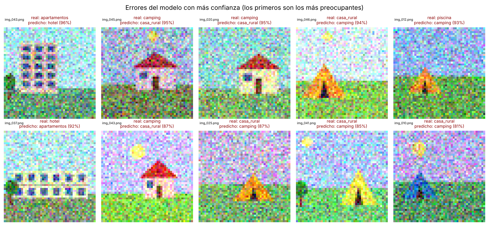

# Análisis de errores · Visión artificial para el cliente (Sprint 11)

## 1. Qué se ha hecho y con qué datos
- **Cliente:** TurisData Canarias. Hoy una persona clasifica a mano las fotos que suben propietarios y huéspedes; queremos saber si un modelo puede **pre-clasificarlas** y en qué se equivoca.
- **Qué clasifica el modelo:** cinco clases (apartamentos, camping, casa rural, hotel, piscina).
- **Datos:** el conjunto **sintético** del curso (dibujos esquemáticos con ruido, **no son fotos reales**), generado por el script del curso, sin personas ni licencias que atender. Fotos por clase: apartamentos 60, camping 60, casa_rural 60, hotel 60, piscina 60.
- **Partición:** 180 de entrenamiento, 60 de validación y 60 de prueba, con `SEMILLA = 42`; la prueba se usó una sola vez.
- **Modelos:** *transfer learning* (base preentrenada en formas y texturas, congelada y con ajuste fino del último bloque) y la misma red **desde cero** como referencia.

## 2. Resultados
Conjunto de prueba (60 imágenes):

| Clase | Precisión | Recall |
|---|---|---|
| apartamentos | 0,86 | 0,86 |
| camping | 0,46 | 0,60 |
| casa_rural | 0,67 | 0,62 |
| hotel | 0,82 | 0,82 |
| piscina | 1,00 | 0,83 |

Exactitud en prueba: transfer + fine-tuning **0,750** · desde cero **0,683**. F1 macro: **0,749** y **0,679**. Con solo 60 imágenes de prueba, un error cambia la exactitud en 1,7 puntos: no sobreinterpretamos la diferencia entre los dos modelos.

## 3. La matriz de confusión
Filas = real, columnas = predicho (apartamentos, camping, casa_rural, hotel, piscina):

| real \ predicho | apartamentos | camping | casa_rural | hotel | piscina |
|---|---|---|---|---|---|
| apartamentos | 12 | 0 | 0 | 2 | 0 |
| camping | 0 | 6 | 4 | 0 | 0 |
| casa_rural | 0 | 5 | 8 | 0 | 0 |
| hotel | 2 | 0 | 0 | 9 | 0 |
| piscina | 0 | 2 | 0 | 0 | 10 |

Los errores se concentran en un par de clases: **casa_rural y camping se confunden en los dos sentidos** (casa_rural → camping: 5; camping → casa_rural: 4). La clase con menor recall es **camping** (0,60). En total hay 15 errores de 60.

## 4. Los errores
Los 8 errores con más confianza (el modelo estaba muy seguro y se equivocó):

| Foto | Verdadera | Predicha | Confianza | Hipótesis de causa (se ve en la foto) | Mejora propuesta |
|---|---|---|---|---|---|
| apartamentos/img_043.png | apartamentos | hotel | 0,96 | Edificio alto con 12 ventanas: se parece a un hotel; la única diferencia entre las dos clases es la altura y el ancho | Más ejemplos de bloques altos de apartamentos y acordar qué distingue cada clase |
| camping/img_045.png | camping | casa_rural | 0,95 | En la foto se ve una casa con tejado rojo y ninguna tienda: la etiqueta de la carpeta camping parece equivocada | Revisar a mano las etiquetas de la carpeta camping |
| camping/img_020.png | camping | casa_rural | 0,95 | En la foto se ve una casa con tejado rojo y ninguna tienda: la etiqueta de la carpeta camping parece equivocada | Revisar a mano las etiquetas de la carpeta camping |
| casa_rural/img_046.png | casa_rural | camping | 0,94 | En la foto se ve una tienda de campaña y ninguna casa: la etiqueta de la carpeta casa_rural parece equivocada | Revisar a mano las etiquetas de la carpeta casa_rural |
| piscina/img_012.png | piscina | camping | 0,93 | En la foto se ve una tienda de campaña y ninguna piscina: etiqueta equivocada | Revisar a mano las etiquetas de la carpeta piscina |
| hotel/img_037.png | hotel | apartamentos | 0,92 | Edificio bajo y ancho con dos filas de ventanas: se parece más a unos apartamentos | Más ejemplos de hoteles bajos y acordar qué distingue cada clase |
| camping/img_043.png | camping | casa_rural | 0,87 | En la foto se ve una casa con tejado rojo y ninguna tienda: la etiqueta de la carpeta camping parece equivocada | Revisar a mano las etiquetas de la carpeta camping |
| casa_rural/img_025.png | casa_rural | camping | 0,87 | En la foto se ve una tienda de campaña y ninguna casa: la etiqueta de la carpeta casa_rural parece equivocada | Revisar a mano las etiquetas de la carpeta casa_rural |

**Lo que vemos:** en 8 de los 10 errores más seguros la foto muestra algo distinto de lo que dice su carpeta (una casa dentro de camping, una tienda dentro de casa_rural o piscina). Probablemente **no falla el modelo, sino la etiqueta**. Los otros dos son edificios que se parecen a la clase contraria (altura y ancho).

## 5. Recomendación al cliente
Con un umbral de 0,7 (elegido con la validación: cobertura 87 % y acierto 92 %), en la prueba el modelo decide solo el **78 %** de las fotos y acierta el **77 %** de ellas; el resto lo revisa una persona.

**No lo dejaríamos decidir solo todavía.** La confianza no protege de las etiquetas mal puestas (el modelo se equivoca con un 90 % de seguridad), y con las etiquetas actuales un 23 % de error en las fotos que decide solo es demasiado. Antes: (1) que dos personas revisen las etiquetas de camping y casa_rural, (2) volver a medir y (3) probar con fotos reales.

## 6. Riesgos de IA responsable
1. Riesgo: **etiquetas dudosas.** Si la carpeta dice una cosa y la foto otra, las métricas castigan al modelo por algo que no ha hecho y se aprende un patrón equivocado. Medida: dos personas revisan las fotos con error confiado antes de reentrenar y se guarda quién las corrigió.
2. Riesgo: **los dibujos no son fotos.** Con fotos reales el rendimiento será otro (fondos, luz, ángulos). Medida: probar con al menos 30 fotos reales por clase antes de usarlo, y no prometer al cliente la exactitud de estos dibujos.
3. Riesgo: **fotos reales con personas o sin licencia.** Medida: no subir fotos al repositorio, usar solo fotos propias o con licencia abierta y apuntar autor y licencia en el README.
