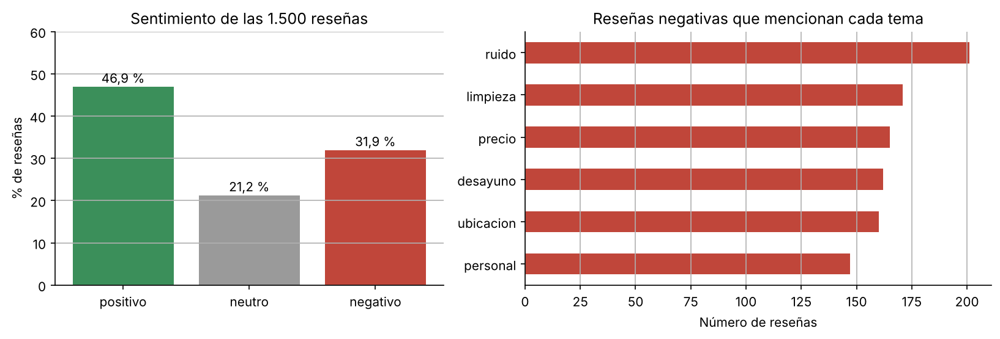

# Informe de reseñas · TurisData Canarias
*Equipo: Las Palmeras · Fecha: 25/11/2026 · Datos: `resenas.csv` (sintéticos, 1.500 reseñas) y `ocupacion_diaria.csv` (sintéticos, 1.096 días)*

## 1. Resumen para la dirección
- **Qué opina la clientela:** 46,9 % de las reseñas son positivas, 21,2 % neutras y 31,9 % negativas: casi la mitad está contenta, pero casi una de cada tres escribe una queja.
- **Lo que más se critica y lo que más se valora:** el **ruido** es el tema que más aparece en las 478 reseñas negativas (201, el 42 %), seguido de limpieza (171) y precio (165). Lo más valorado es la **limpieza** (249 reseñas positivas lo mencionan), el silencio (tema ruido) (244) y la ubicación (244).
- **Lo que recomendamos hacer primero:** atajar el **ruido nocturno**: de cada 100 reseñas positivas o negativas que hablan de ruido, 45 son negativas; en los demás temas son entre 40 y 41.
- **Ocupación de la semana que viene:** La previsión de ocupación a 7 días se equivoca de media 3,2 puntos de ocupación (un 4,4 % de la ocupación media), un 28,5 % menos que repetir la semana anterior (4,5 puntos). Para el 1–7 de enero de 2026 prevemos entre un 76 % (el miércoles 7) y un 93 % (el sábado 3).

## 2. Sentimiento

Porcentajes: **46,9 % positivas · 21,2 % neutras · 31,9 % negativas** (704, 318 y 478 reseñas).

Tres citas reales:
1. «Viajamos en familia. Todo estaba muy limpio.» (`id_resena`: 41) · positiva
2. «En general, Cumple lo básico!» (`id_resena`: 12) · neutra
3. «Fuimos por trabajo. Se oye todo de la habitación de al lado.» (`id_resena`: 51) · negativa

**Exactitud del clasificador en prueba: 0,992** (372 de 375 reseñas que el modelo no había visto; decir siempre «positivo» acertaría 0,469). Los 3 errores son neutras que el modelo confunde con negativas. Para el cliente: se puede **medir** el sentimiento de forma automática, pero con cautela (ver apartado 5).

## 3. Temas
| Tema más criticado | Reseñas negativas que lo mencionan | Ejemplo real |
|---|---|---|
| **ruido** | 201 | «Fuimos por trabajo. Se oye todo de la habitación de al lado.» (`id_resena`: 51) |
| **limpieza** | 171 | «Viajamos en familia. La limpieza deja mucho que desear...» (`id_resena`: 13) |
| **precio** | 165 | «Pasamos una semana aquí. Cobran extras por todo...» (`id_resena`: 2) |

| Tema más valorado | Reseñas positivas que lo mencionan | Ejemplo real |
|---|---|---|
| **limpieza** | 249 | «Viajamos en familia. Todo estaba muy limpio.» (`id_resena`: 41) |
| **silencio (tema ruido)** | 244 | «Silencio total por las noches!» (`id_resena`: 26) |
| **ubicación** | 244 | «Viajamos en familia. Vistas al mar increíbles!» (`id_resena`: 149) |

Expresiones que más se repiten en las negativas (n-gramas): «ruido constante» (69 reseñas, casi siempre con «noche») y «ruidosa poco segura» (61). Ojo: **mencionar un tema no es criticarlo**; el detector busca palabras, así que una reseña negativa puede alabar el desayuno y quejarse del ruido.

## 4. Recomendaciones (3, accionables)
1. **Qué:** reducir el ruido nocturno (revisar el volumen de la música del bar a partir de las 23:00, que es cuando empieza el horario de silencio, y avisar en recepción a las habitaciones con quejas). **Quién:** dirección de operaciones con el responsable del bar. **Cómo sabremos que funciona:** porque el 42 % de reseñas negativas que hoy mencionan el ruido (201 de 478) baje al 30 % en el próximo trimestre, medido con el mismo cuaderno `resenas.ipynb`.
2. **Qué:** una lista de control diaria de limpieza por habitación (pelos, sábanas, toallas), con revisión al azar de 5 habitaciones al día. **Quién:** gobernanta. **Cómo sabremos que funciona:** porque las 171 reseñas negativas que hablan de limpieza (36 % de las negativas) bajen al 25 % de las negativas en el próximo trimestre.
3. **Qué:** usar la previsión de ocupación a 7 días (SARIMAX) cada lunes para planificar turnos de recepción y limpieza. **Quién:** dirección con recepción. **Cómo sabremos que funciona:** porque el error medio semanal se mantenga por debajo de 4,5 puntos de ocupación, que es el del método simple de «repetir la semana anterior»; si lo supera, se vuelve a ese método.

## 5. Límites y cautelas
- **Datos sintéticos:** 1.500 reseñas y 1.096 días inventados. Las reseñas son más repetitivas que las reales, por eso la exactitud es tan alta (0,992); con reseñas reales esperaríamos bastante menos.
- **Negación e ironía:** el clasificador no entiende el orden de las palabras. «La limpieza no es impecable» la clasifica como **positivo**. Es un límite conocido de este método.
- **Temas:** se detectan por palabras clave (acierto del detector por tema entre 0,94 y 1,00 de F1 contra los temas anotados) y no distinguen si la opinión sobre ese tema es buena o mala.
- **Previsión:** el error medio es de 3,2 puntos de ocupación (4,4 % de la ocupación media, 72,5 %), medido en 13 semanas de prueba (del 2/10/2025 al 31/12/2025); para el 1–7 de enero de 2026 hemos supuesto que los festivos son los mismos que el año anterior.
- **Datos personales:** no hay correos, teléfonos ni DNI en las 1.500 reseñas (comprobado con expresiones regulares); en una versión real se anonimizarían antes de guardar y citar.
