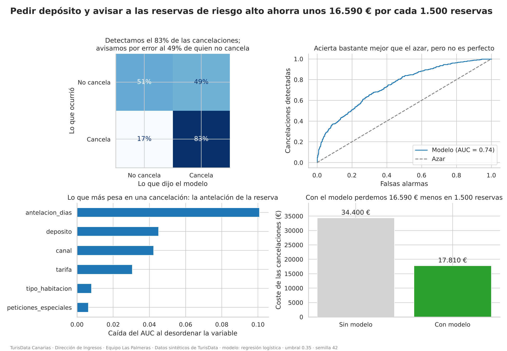

# Informe visual · Regresión logística para TurisData Canarias

**Para:** Dirección (Marcos) · **Equipo:** Las Palmeras · **Fecha:** 25/11/2026 · **Versión:** 1

---

## TITULAR: Pedir depósito y avisar a las reservas de riesgo alto ahorra unos 16.590 € por cada 1.500 reservas

## Los cuatro gráficos

| ¿Qué falla y cuánto? | ¿Podemos fiarnos del modelo? |
|---|---|
| **Detectamos el 83 % de las cancelaciones; avisamos por error al 49 % de quien no cancela** — Gráfico 1: matriz de confusión (en %) | **Acierta bastante mejor que el azar, pero no es perfecto** — Gráfico 2: curva ROC |
| Dejar escapar una cancelación cuesta 50 € y una falsa alarma 30 €, así que aceptamos avisar de más antes que dejar escapar cancelaciones. | El AUC (la probabilidad de que el modelo dé más riesgo a una reserva que cancela que a una que no) es 0,74; 0,5 sería azar y 1, perfecto. |
| **¿Qué mueve el resultado?** | **¿Cuánto vale?** |
| **Lo que más pesa en una cancelación: la antelación de la reserva** — Gráfico 3: importancia de variables | **Con el modelo perdemos 16.590 € menos en 1.500 reservas** — Gráfico 4: ahorro en € con y sin el modelo |
| La antelación pesa 0,10 puntos de AUC, más del doble que el depósito (0,045). Pesar en el modelo no es causar. | Supuestos: cada cancelación no detectada = 50 €, cada falsa alarma = 30 €. Sin modelo 34.400 €; con modelo 17.810 €. |

## Tres viñetas
- **Qué hemos hecho:** un modelo que estima la probabilidad de que cada reserva se cancele, con 6.000 reservas anteriores; lo hemos puesto a prueba con 1.500 que no había visto.
- **Qué recomendamos:** que **Ingresos y recepción** avisen y pidan depósito a toda reserva con probabilidad de cancelar de 35 % o más, desde la próxima semana. Ahorra unos **16.590 €** por cada 1.500 reservas (unos 11 € por reserva). Con el umbral 0,35 el coste es el más bajo; con 0,50 sería 19.710 € en lugar de 17.810 €.
- **Qué límites tiene:** los datos son sintéticos y las relaciones no son estadísticas reales del turismo; de cada 10 avisos, 4 son falsas alarmas; detecta peor en el canal directo (62 %) que en la web intermediaria (91 %); no debe usarse para negar reservas; se revisa cada trimestre.

## IA responsable
- **Riesgo:** el modelo avisa más a quien reserva por la web intermediaria: detecta el 91 % de sus cancelaciones, pero también avisa por error al 65 % de quien no cancela (en el canal directo, el 29 %). Entre países, la detección va del 80 % (NL) al 94 % (IT). **Medida:** el modelo solo sirve para priorizar avisos y pedir depósito, nunca para negar reservas; se vuelve a medir por canal y por país cada trimestre.
- **Uso de la IA:** se pidió explicar la importancia por permutación y revisar la redacción de los títulos; se comprobó que cada cifra sale de las variables del cuaderno y que todo se calcula con el test; se cambió un título que decía «el depósito evita las cancelaciones», porque el gráfico muestra lo que pesa en el modelo, no la causa. Datos sintéticos.

## Pie
Datos: `reservas_turisdata.csv` (sintéticos, n = 6.000, llegadas del 13/01/2024 al 04/12/2026; test = 1.500) · Modelo: regresión logística · Umbral: 0,35 · Semilla: 42 · Notebook: `informe_visual.ipynb` · Versiones: Python 3.13.18, numpy 2.5.3, pandas 2.3.3, scikit-learn 1.9.1, matplotlib 3.11.2, seaborn 0.13.2 · Responsable: Persona D (equipo Las Palmeras)

---

## Revisión con la rúbrica

**Revisado por:** Persona D (no escribió esa parte) · **Fecha:** 25/11/2026

| Criterio | Nivel (1–4) | Prueba: una frase de lo que has comprobado |
|---|---|---|
| Corrección técnica | 4 | Cuatro gráficos sobre el test, barras desde 0, sin 3D; el ahorro del gráfico (16.590 €) coincide con el del cuaderno; compara dos umbrales y dos modelos con los costes (logística 17.810 € frente a boosting 19.190 €) y justifica el 0,35 |
| Reproducibilidad | 4 | Reiniciar y ejecutar todo dio el mismo PNG y las mismas cifras; el pie indica datos, modelo, umbral, semilla y versiones, y el PNG va junto al informe |
| Análisis y comunicación al cliente | 4 | El equipo Los Roques entendió la decisión («avisar y pedir depósito a las de riesgo alto») en 30 segundos; todos los títulos son conclusiones, el AUC va explicado, el valor está en euros y la recomendación dice quién, cuándo y con qué umbral |
| IA responsable | 4 | Riesgo específico con cifra (falsas alarmas 65 % en web intermediaria frente a 29 % en directo) y medida; dice qué se pidió a la IA y qué se revisó; datos sintéticos declarados |

**Lo primero que mejoraríamos:** calcular el ahorro con los costes reales del hotel y probar un umbral distinto por canal, porque la web intermediaria recibe muchas más falsas alarmas.
